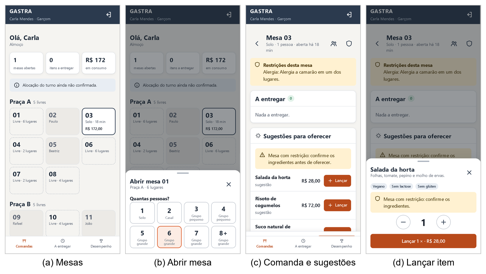
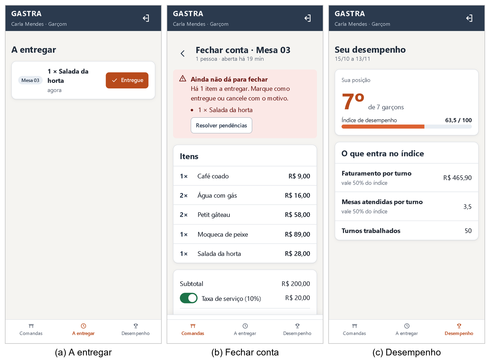
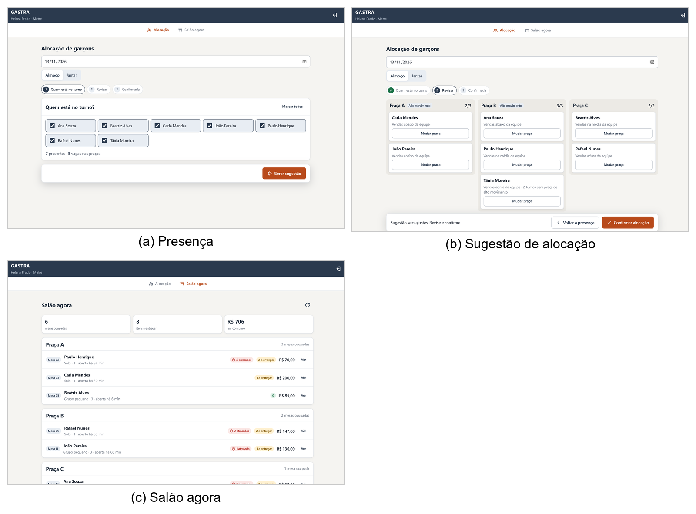
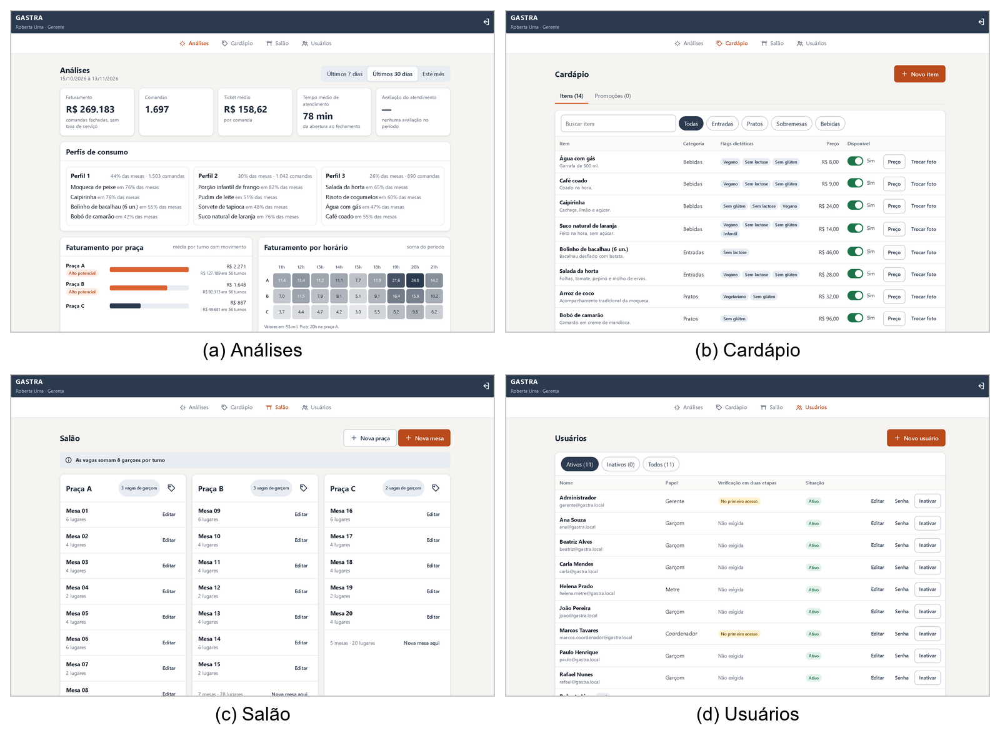
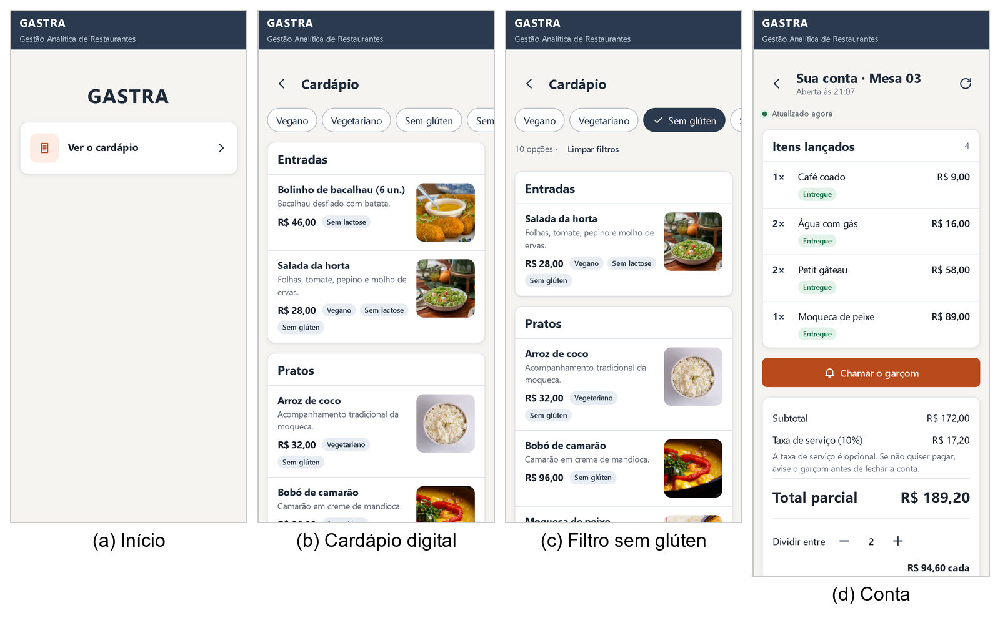
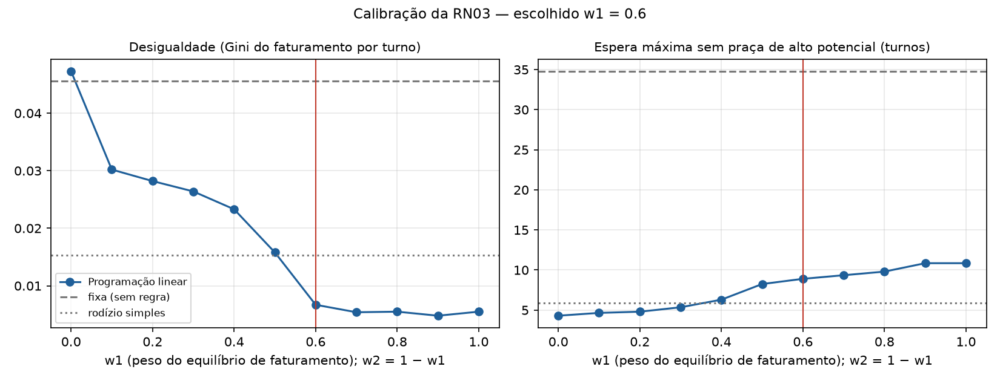
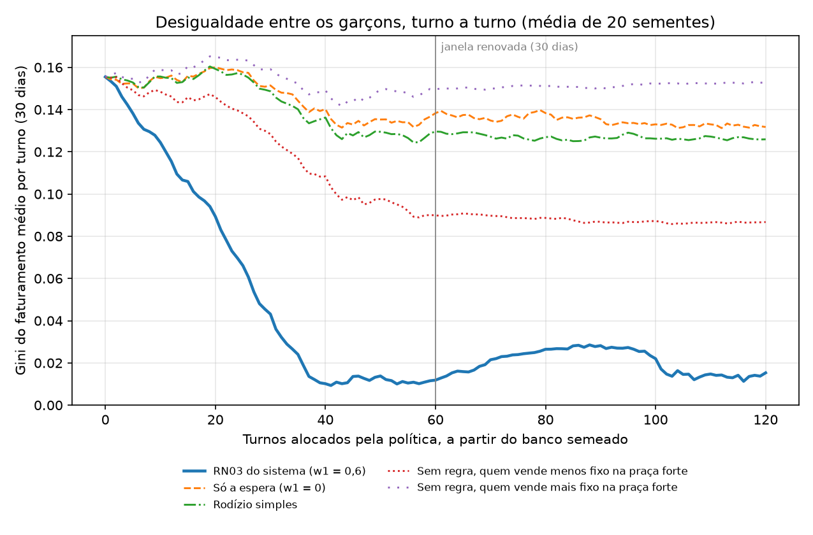

# 5 DESENVOLVIMENTO, RESULTADOS E TESTES

Este capítulo apresenta o produto construído e as evidências de que ele cumpre o que foi especificado. A seção 5.1
apresenta o sistema do ponto de vista de cada usuário. A seção 5.2 reúne a validação: o processo de desenvolvimento e
a integração contínua (5.2.1), os testes automatizados (5.2.2), os dois estudos feitos sobre os algoritmos — a
calibração dos pesos da alocação de garçons (5.2.3) e a validação dos blocos analíticos sobre um histórico simulado
(5.2.4) —, a avaliação heurística das telas (5.2.5) e os testes operacionais (5.2.6). Os números deste capítulo correspondem ao estado do
repositório em 5 de novembro de 2026 e são reproduzíveis: cada tabela indica o script ou o teste que a gera.

## 5.1 APRESENTAÇÃO DO PRODUTO E TELAS

O GASTRA é uma aplicação web única, que apresenta a cada papel apenas as telas que lhe cabem. Esta seção percorre
o sistema em funcionamento, pela perspectiva de cada usuário; as figuras são capturas do sistema completo em
execução, com os dados simulados do semeador, e o funcionamento detalhado de cada tela está no manual do usuário,
no Apêndice A.

O Garçom usa o sistema no celular (Figura 18). A tela inicial mostra as mesas do salão, com as da praça em que ele
foi alocado no turno destacadas, e abre uma mesa em dois toques — a mesa livre e a quantidade de pessoas —, dentro
do limite do RNF02. Na comanda, ele vê as restrições da mesa, os itens a entregar e as sugestões de pratos, e
lança cada item em dois toques. Se a mesa tem uma restrição que o item não atende, o sistema avisa antes do
lançamento, sem impedi-lo; se o serviço analítico estiver fora do ar, a comanda continua funcionando e apenas as
sugestões deixam de aparecer. A tela A entregar reúne os itens pendentes de todas as mesas do garçom, do mais
antigo ao mais novo, e marca como atrasado o que passou de 15 minutos (Figura 19). O fechamento só é liberado com
todos os itens entregues ou cancelados com motivo (RN02), e a taxa de serviço vem incluída, removível e
recolocável a pedido do cliente. Em Desempenho, o garçom vê a própria posição e o índice que a explica, sem os
valores dos colegas.

**Figura 18 – Garçom: do salão ao lançamento do item**

Fonte: elaborado pelos autores.

**Figura 19 – Garçom: itens a entregar, fechamento e desempenho**

Fonte: elaborado pelos autores.

O Metre monta o turno em três passos (Figura 20): marca os garçons presentes, recebe a sugestão de alocação e a
confirma, podendo antes mover qualquer garçom de praça. A sugestão mostra, embaixo do nome de cada garçom, o
motivo da escolha — a faixa de vendas em relação à equipe e há quantos turnos ele não recebe uma praça de alto
movimento —, sem exibir valores de faturamento, que são indicadores restritos ao Gerente (decisão D14). Depois de
confirmada, a alocação não muda mais e passa a compor o histórico usado pela RN03. Em Salão agora, o Metre
acompanha as mesas ocupadas de cada praça, com os itens a entregar e os atrasados.

**Figura 20 – Metre: alocação do turno e salão**

Fonte: elaborado pelos autores.

O Gerente acompanha a operação pelos relatórios de Business Intelligence (Figura 21): faturamento, ticket médio e
tempo médio de atendimento no período; os perfis de consumo encontrados pela clusterização, com os itens que
caracterizam cada tipo de mesa; faturamento por praça, com destaque para as de alto potencial, pela mesma regra
usada na alocação; faturamento por hora, em mapa de calor; ranking dos garçons pelo índice de desempenho; itens
mais vendidos; e a engenharia de cardápio, que separa os itens em estrela, burro de carga, quebra-cabeça e cão
pela popularidade e pelo valor de venda dentro da categoria (KASAVANA; SMITH, 1982). O Gerente também gerencia o
cardápio, com fotos e promoções, as praças, as mesas e as contas de usuário; o Coordenador tem acesso somente ao
cardápio e às promoções.

**Figura 21 – Gerente: análises, cardápio, salão e usuários**

Fonte: elaborado pelos autores.

O Cliente não se autentica (Figura 22). Na tela da comanda, o garçom mostra um QR code que abre a conta da mesa no
celular do cliente; ali ele acompanha os itens lançados e a situação de cada um, atualizados a cada segundo
(RNF01), chama o garçom e divide o total entre as pessoas da mesa. O cardápio digital tem fotos e filtros por
restrição alimentar. Depois que a conta é fechada, o cliente pode avaliar o atendimento com uma nota de 1 a 5 e um
comentário opcional, sem que nada o identifique.

**Figura 22 – Cliente: cardápio digital e conta**

Fonte: elaborado pelos autores.

## 5.2 TESTES E VALIDAÇÃO DO SOFTWARE

### 5.2.1 Processo de desenvolvimento e integração contínua

O trabalho foi organizado em dez marcos no quadro de projeto do GitHub, do levantamento de requisitos (M1) à
defesa (M10), e executado em sprints semanais, conforme descrito na seção 1.5. Cada tarefa foi registrada como
issue, com critérios de aceite, prioridade, marco e sprint, e cada mudança no repositório entrou por Pull
Request: uma regra do repositório impede a integração na branch de desenvolvimento sem a aprovação do outro
integrante. Entre 17 de agosto e 5 de novembro de 2026, foram
integrados 104 Pull Requests e fechadas 123 issues.

A revisão cruzada foi apoiada por integração contínua: a cada Pull Request, o GitHub Actions (GITHUB, 2026) executa cinco
verificações independentes, cujo resultado aparece no próprio Pull Request para o revisor. A primeira compila o backend e
executa os seus testes contra um MySQL real e contra o serviço analítico em execução, e falha também se algum
teste tiver sido ignorado — o que impede que um teste de banco deixe de rodar sem que ninguém perceba. A segunda
executa os testes da camada analítica; a terceira compila o frontend e executa os seus testes; a quarta constrói
a imagem Docker do frontend e verifica que ela sobe, responde e se declara saudável; e a quinta varre o
repositório em busca de segredos, como senhas e chaves, que não devem ser versionados.

Esse conjunto de verificações encontrou defeitos que a revisão humana deixaria passar. Um exemplo registrado no
projeto é o da imagem do frontend: o servidor nginx recusava-se a iniciar quando o backend ainda não estava no ar,
porque tentava resolver o nome do serviço na partida, e o problema só apareceu na integração contínua, que sobe a
imagem sozinha. Outro exemplo mostra o limite da própria verificação: o contêiner do frontend respondia
normalmente pela porta publicada, mas a sua checagem de saúde interna falhava, porque, dentro do contêiner, o nome
"localhost" resolvia para o endereço IPv6, que o servidor não escutava. A integração contínua, que testava apenas
por fora, não o detectou; o defeito foi encontrado durante a execução do sistema completo, corrigido e passou a
ser verificado também pela integração contínua.

### 5.2.2 Testes automatizados

A verificação do GASTRA apoia-se em testes automatizados escritos junto do código, em todas as camadas. No
backend, os testes de unidade verificam as regras do domínio sem banco nem rede — a composição da mesa, o cálculo
da taxa, o bloqueio de conta, o índice de desempenho —, e os testes de integração sobem a interface de programação
completa e fazem requisições reais a ela, verificando código de resposta, mensagem, permissão de cada papel e
registro de auditoria. Os objetos que só existem no banco — views, triggers e restrições CHECK — são testados
contra um MySQL real, e a comunicação com o serviço analítico é testada tanto com um dublê, para simular falhas e
lentidão, quanto contra o serviço real em execução. Na camada analítica, os testes verificam os algoritmos e o
contrato do serviço; no frontend, verificam cada tela e os serviços de sessão e navegação. Testes de arquitetura,
nas duas linguagens, garantem que a regra de dependência entre as camadas continua valendo.

A Tabela 2 apresenta o resultado da execução completa, organizado pelos blocos do trabalho. Um cenário é o que o
teste verifica; um caso é cada execução do cenário, já que um mesmo cenário pode ser executado com vários
conjuntos de dados.

**Tabela 2 – Testes automatizados executados, por bloco**

| Bloco | Cenários | Casos | Aprovados |
|---|---:|---:|---:|
| Núcleo de comandas | 126 | 135 | 135 |
| Cardápio e promoções | 62 | 83 | 83 |
| Alocação de garçons (programação linear) | 61 | 67 | 67 |
| Recomendação de pratos (ciência de dados) | 52 | 58 | 58 |
| BI e índice de desempenho | 54 | 58 | 58 |
| LGPD, auditoria e segurança | 108 | 109 | 109 |
| Banco de dados (views, triggers e restrições) | 14 | 14 | 14 |
| Integração backend e serviço analítico | 12 | 15 | 15 |
| Arquitetura e infraestrutura | 9 | 13 | 13 |
| **Total** | **498** | **552** | **552** |

Fonte: elaborado pelos autores, a partir da execução de 05/11/2026 (script `gerar_relatorio_testes.py`).

Os 552 casos foram aprovados, nenhum falhou e nenhum foi ignorado. Por camada, são 350 casos no backend, 66 na
camada analítica e 136 no frontend. Cada bloco do trabalho é verificado nas três camadas: a mesma regra de
negócio é testada no domínio, na interface de programação e na tela que a apresenta ao usuário. O bloco de
proteção de dados é o segundo maior, porque cada restrição da LGPD foi traduzida em ao menos um teste que falha se
ela for violada — por exemplo, o que verifica que nenhuma view expõe dado pessoal, o que verifica que o Gerente
nunca recebe a restrição alimentar do cliente e o que verifica que a avaliação do atendimento não guarda nada que
identifique quem avaliou. A relação entre cada história de usuário e os testes que comprovam os seus critérios de
aceite está no Quadro 5 (seção 4.2).

Os requisitos não funcionais foram verificados da forma que cada um permite. O RNF02 é verificado por um teste da
tela de mesas, que abre uma mesa em dois toques. O RNF05 é verificado pelos testes que derrubam o serviço
analítico e conferem que a comanda continua aceitando pedidos e que o Metre consegue alocar manualmente. O RNF03 e
o RNF04 são verificados pelos testes de permissão de cada papel e de proteção de dados. O RNF01, que limita a dois
segundos o tempo para um pedido aparecer na comanda, depende do sistema em operação e é tratado na seção 5.2.6.

### 5.2.3 Calibração dos pesos da alocação

A RN03 combina dois fatores com os pesos w1, para o equilíbrio de faturamento, e w2, para o tempo desde a última
praça de alto potencial, com w1 + w2 = 1. Como o restaurante colaborador não forneceu histórico e o sistema ainda
não tinha movimento real, os pesos foram definidos por simulação, com premissas explícitas: um salão com sete
garçons e três praças de potencial diferente — forte, com três vagas e faturamento médio de R$ 1.800 por turno;
média, com três vagas e R$ 1.200; e fraca, com duas vagas e R$ 600 —, presença de 85% por garçom e por turno,
variação de 25% no movimento de cada praça entre turnos e de 10% no desempenho individual. Cada simulação cobriu
120 turnos, o equivalente a 60 dias com almoço e jantar, e foi repetida com 20 sementes aleatórias para cada peso
testado. A cada turno, a alocação foi resolvida pela mesma função de programação linear usada pelo sistema em
produção.

Duas métricas foram medidas. A principal é a desigualdade, dada pelo coeficiente de Gini (GINI, 1912) do faturamento médio por
turno de cada garçom, em que zero significa todos iguais: é a dor que apareceu espontaneamente na pesquisa de
campo. A secundária é a espera máxima: a maior sequência de turnos em que algum garçom trabalhou sem receber uma
praça de alto potencial. Para comparação, duas políticas de referência rodaram nas mesmas sementes: uma sem regra,
em que cada garçom tende a ficar sempre na mesma praça, e um rodízio simples, que gira a ordem dos garçons a cada
turno. Os resultados estão na Tabela 3 e na Figura 23.

**Tabela 3 – Resultado da calibração dos pesos da RN03**

| Política | Gini médio | Espera máxima média (turnos) |
|---|---:|---:|
| w1 = 0,0 | 0,0473 | 4,30 |
| w1 = 0,1 | 0,0302 | 4,65 |
| w1 = 0,2 | 0,0282 | 4,80 |
| w1 = 0,3 | 0,0264 | 5,35 |
| w1 = 0,4 | 0,0233 | 6,30 |
| w1 = 0,5 | 0,0158 | 8,25 |
| **w1 = 0,6** | **0,0067** | **8,90** |
| w1 = 0,7 | 0,0054 | 9,35 |
| w1 = 0,8 | 0,0055 | 9,80 |
| w1 = 0,9 | 0,0048 | 10,85 |
| w1 = 1,0 | 0,0055 | 10,85 |
| Sem regra | 0,0456 | 34,80 |
| Rodízio simples | 0,0153 | 5,90 |

Fonte: elaborado pelos autores, com 20 sementes de 120 turnos para cada política.

**Figura 23 – Desigualdade e espera máxima em função do peso w1**

Fonte: elaborado pelos autores.

Qualquer peso é muito melhor do que não ter regra: a espera máxima cai de 34,8 para, no máximo, 10,9 turnos. As
duas métricas, porém, puxam para lados opostos — mais peso no faturamento reduz a desigualdade e aumenta a espera
—, e nenhum peso supera o rodízio simples nas duas ao mesmo tempo. O critério de escolha seguiu a prioridade da
pesquisa: entre os pesos cuja desigualdade fica até 50% acima da menor obtida, escolhe-se o menor w1, que é o que
mais protege a espera. O menor Gini foi 0,0048, com w1 = 0,9; aceitam-se, portanto, valores até 0,0072, o que
inclui os pesos de 0,6 a 1,0, e o menor deles é w1 = 0,6. Com esse peso, a desigualdade fica 56% menor que a do
rodízio simples, com uma espera 51% maior, de 8,9 turnos — cerca de quatro dias e meio de trabalho. A escolha é
estável: com tolerância de 25%, o critério escolheria 0,7; com 100%, novamente 0,6.

A calibração também revelou um defeito na formulação original do primeiro fator. Na primeira rodada, o fator era
o faturamento acumulado do garçom nos últimos 30 dias, e a programação linear foi pior que o rodízio simples em
desigualdade. A causa: pela soma, quem faltou mais turnos aparece com menos faturamento e é tratado como quem
está para trás, recebendo as melhores praças ao voltar. O fator foi corrigido para o faturamento médio por turno
trabalhado, tanto no backend quanto no serviço analítico, e a Tabela 3 já corresponde à versão corrigida. O
episódio mostra o valor de simular antes de operar: o defeito não seria visível em um teste de unidade, porque a
fórmula estava implementada exatamente como especificada.

### 5.2.4 Validação sobre dados simulados

Para verificar os blocos analíticos em funcionamento, e não apenas isoladamente, o banco foi preenchido com um
histórico simulado por uma ferramenta que grava pelas mesmas entidades do domínio usadas pelo sistema (decisão
D11), de modo que os dados respeitam as mesmas regras de composição da mesa, taxa e totais. Com a semente 42, a
ferramenta gerou 70 dias de operação, com 4.204 comandas fechadas e 13.914 itens, em um banco separado do usado no
desenvolvimento. Os dados são fictícios e não representam o restaurante colaborador.

O histórico foi gerado com dois gabaritos embutidos, que os algoritmos precisam redescobrir sem que ninguém os
informe. O primeiro são combinações de consumo, como "quem pede moqueca pede arroz de coco" com 85% de
probabilidade, que servem de gabarito às regras de associação. O segundo são três perfis de consumo — um almoço
executivo, com salada, risoto, suco, água e café; uma refeição de frutos do mar, com moqueca, bobó, bolinho de
bacalhau, caipirinha e petit gâteau; e uma refeição em família, com porção infantil, suco, arroz de coco e
sobremesas —, dos quais cada comanda é sorteada conforme o período e a quantidade de pessoas da mesa. Período e
pessoas não entram na clusterização, que recebe apenas os itens pedidos; servem somente para conferir, depois, se
os grupos encontrados fazem sentido.

A clusterização escolheu, pela silhueta, exatamente três perfis (silhueta de 0,387, contra 0,351 para dois e para
quatro), apresentados na Tabela 4.

**Tabela 4 – Perfis de consumo encontrados pela clusterização no histórico simulado**

| Perfil | Comandas | Itens que mais se destacam (presença no perfil) | Comandas no almoço | Mesas com 3 ou mais pessoas |
|---|---:|---|---:|---:|
| Família | 1.290 (31%) | Porção infantil (74%), pudim (46%), sorvete de tapioca (46%), suco (73%) | 53% | 72% |
| Almoço executivo | 1.080 (26%) | Risoto (57%), salada (60%), água com gás (45%), café (45%) | 76% | 17% |
| Frutos do mar | 1.798 (43%) | Moqueca (62%), bolinho de bacalhau (54%), caipirinha (67%), bobó (37%) | 31% | 33% |

Fonte: elaborado pelos autores (script `validar_dados_semeados.py`).

Os itens de cada grupo são os do perfil embutido, e as duas colunas da direita, calculadas com informações que o
algoritmo nunca recebeu, confirmam a leitura: o grupo do almoço executivo é composto em três quartos por comandas
do almoço e quase só por mesas de uma ou duas pessoas, e o grupo da família, em três quartos por mesas de três ou
mais pessoas. No simulador, em que se conhece o perfil de origem de cada comanda, a concordância entre os grupos
encontrados e os embutidos, medida pelo índice de Rand ajustado — em que 1 indica concordância perfeita e 0, a que
o acaso produziria —, ficou entre 0,84 e 0,88 em três sementes diferentes.

Para medir se a segmentação ajuda o garçom, adotou-se a avaliação por item escondido: 70% das comandas treinaram
os modelos, e, em cada comanda restante, um item foi escondido por vez, verificando-se se ele voltava na primeira
sugestão e entre as três sugestões feitas a partir dos demais. O resultado está na Tabela 5.

**Tabela 5 – Acerto da recomendação de pratos na avaliação por item escondido**

| Recomendação | Acerto na primeira sugestão | Acerto entre as três sugestões |
|---|---:|---:|
| Somente regras de associação | 50,0% | 76,2% |
| Segmentada por perfil (clusterização e regras de associação) | 57,1% | 83,1% |

Fonte: elaborado pelos autores, com 70% das comandas para treino e 30% para teste.

A recomendação segmentada acertou cerca de 7 pontos percentuais a mais nas duas medidas. A primeira sugestão é a que
mais importa no salão, por ser a que o garçom tende a oferecer; foi a observação dela, em um histórico sem perfis
nítidos, que revelou um defeito na primeira versão da recomendação segmentada — as três fontes de sugestão eram
apenas enfileiradas, e uma regra fraca passava à frente de um item que quase toda mesa do perfil pedia —, corrigido
ordenando-se as sugestões do perfil pela confiança. A diferença aparece com clareza em uma mesa que
pediu salada e suco: as regras gerais sugerem a porção infantil, porque o suco aparece com frequência junto dela
nas famílias, enquanto a recomendação segmentada reconhece o almoço executivo e sugere risoto, café e água. As
combinações embutidas também foram reencontradas pelas regras de associação: para uma comanda que tinha apenas a
moqueca, a primeira sugestão foi o arroz de coco, com confiança de 0,853 para uma probabilidade embutida de 0,85, e
lift de 2,1, o que indica uma associação bem maior do que o acaso explicaria.

A alocação de garçons, calculada sobre o faturamento dos últimos 30 dias devolvido pelas views e sobre o histórico
de alocações confirmadas, está na Tabela 6.

**Tabela 6 – Alocação calculada sobre o histórico simulado**

| Garçom | Faturamento por turno (R$) | Turnos sem praça de alto potencial | Praça designada | Potencial da praça (R$ por turno) |
|---|---:|---:|---|---:|
| 4 | 493,96 | 0 | 2 | 1.518 |
| 5 | 583,87 | 3 | 1 | 2.254 |
| 6 | 639,59 | 1 | 2 | 1.518 |
| 7 | 775,27 | 3 | 1 | 2.254 |
| 8 | 826,39 | 0 | 2 | 1.518 |
| 10 | 1.084,02 | 0 | 3 | 787 |
| 9 | 1.096,17 | 0 | 3 | 787 |

Fonte: elaborado pelos autores (script `validar_dados_semeados.py`).

A tabela mostra os dois fatores da RN03 atuando juntos. Os dois garçons que mais faturaram por turno ficaram na
praça de menor potencial, e as vagas da praça de maior potencial foram para dois dos que menos faturaram. O garçom
que menos faturou, porém, não a recebeu: ele havia acabado de sair dela, sem nenhum turno de espera, enquanto os
garçons 5 e 7 faturavam pouco e esperavam havia três turnos. Com peso de 0,4 para a espera, a regra dá a vez a quem
espera, em vez de devolver a praça de maior movimento sempre à mesma pessoa — exatamente o rodízio que o segundo
fator existe para garantir.

Uma divergência foi registrada como achado. O coeficiente de Gini do faturamento por turno no histórico simulado é
0,1555, muito acima dos valores da calibração. A diferença é esperada, porque as duas medidas não medem a mesma
coisa: a calibração mede a desigualdade depois de 120 turnos aplicando a RN03, e o histórico simulado é o estado
inicial, com garçons de desempenho propositalmente diferente — o que mais fatura ganha 2,2 vezes o que menos
fatura — e distribuídos por rodízio neutro. É o problema que a RN03 existe para corrigir.

Para verificar se a regra de fato o corrige, e não apenas escolhe bem um turno isolado, mediu-se a desigualdade ao
longo do tempo a partir desse estado inicial. O ponto de partida foi lido das views do banco: o faturamento de cada
garçom por turno nos últimos 30 dias, os turnos de espera de cada um, o movimento médio de cada praça e o fator de
venda de cada garçom, estimado pela razão entre o ticket médio das suas comandas e o ticket médio do restaurante. A
partir daí, simularam-se 120 turnos, o equivalente a 60 dias, com cinco políticas de alocação, nas mesmas 20
sementes, resolvendo-se a cada turno a mesma programação linear usada pelo sistema. A cada turno, calculou-se o
Gini do faturamento médio por turno de cada garçom nos 30 dias anteriores, que é a desigualdade percebida pela
equipe e a janela usada pela própria RN03. Os resultados estão na Figura 24 e na Tabela 7.

**Figura 24 – Desigualdade entre os garçons, turno a turno, conforme a política de alocação**

Fonte: elaborado pelos autores (script `evolucao_gini_rn03.py`).

**Tabela 7 – Coeficiente de Gini do faturamento por turno, conforme a política de alocação**

| Política | Início | Após 30 dias | Após 60 dias |
|---|---:|---:|---:|
| RN03 do sistema (w1 = 0,6) | 0,1555 | 0,0118 | 0,0153 |
| Somente a espera (w1 = 0) | 0,1555 | 0,1383 | 0,1317 |
| Rodízio simples | 0,1555 | 0,1296 | 0,1259 |
| Sem regra, com quem vende menos fixo na praça de maior movimento | 0,1555 | 0,0899 | 0,0867 |
| Sem regra, com quem vende mais fixo na praça de maior movimento | 0,1555 | 0,1495 | 0,1525 |

Fonte: elaborado pelos autores, com a média de 20 sementes para cada política.

Com a RN03, a desigualdade caiu 92% em 30 dias e permaneceu abaixo de 0,03 dali em diante. O rodízio simples e a
política que considera somente a espera quase não a reduziram: dar a todos a mesma chance de ocupar a praça de maior
movimento não compensa a diferença de desempenho individual, e é o primeiro fator da regra — levar quem faturou
menos para onde há mais movimento — que o faz. A ausência de regra mostrou-se uma loteria: a mesma política fixa
terminou com Gini de 0,087 ou de 0,153, conforme quem estava fixo na praça de maior movimento. Na primeira rodada do
experimento, apenas a primeira dessas ordens havia sido testada, e ela pareceu superior ao rodízio; a inversão da
ordem mostrou que o resultado vinha de uma coincidência dos dados, e não da política. Cabe notar que o objetivo da
regra não é levar o Gini a zero: quem vende mais deve ganhar mais, e a RN03 corrige a parcela da desigualdade que vem
da praça, cabendo ao índice de desempenho (RF11) reconhecer o desempenho individual.

### 5.2.5 Avaliação heurística

As telas foram desenhadas primeiro em um protótipo navegável em HTML, importado no Figma, e implementadas em
Angular a partir dele. As telas implementadas foram submetidas a uma avaliação heurística, método de inspeção em
que avaliadores percorrem a interface e confrontam cada tela com um conjunto de princípios reconhecidos de
usabilidade (NIELSEN, 1994). Avaliou-se a tela implementada, e não o protótipo, porque é ela que o usuário vai
usar, e porque as correções passam a valer no sistema entregue. Foram usadas as dez heurísticas de Nielsen (1994): visibilidade do
estado do sistema; correspondência entre o sistema e o mundo real; controle e liberdade do usuário; consistência e
padrões; prevenção de erros; reconhecimento em vez de memorização; flexibilidade e eficiência de uso; estética e
design minimalista; ajuda para reconhecer, diagnosticar e corrigir erros; e ajuda e documentação, numeradas de H1 a H10 nessa ordem.

A avaliação percorreu as 21 telas do sistema em execução — as quatro do cliente, o acesso, as sete do garçom, as
três do Metre, as quatro do Gerente e a de conta não encontrada —, no tamanho de tela de cada papel: celular para
o garçom e o cliente, computador para o Metre e o Gerente. Ela foi conduzida com o apoio de um assistente de
inteligência artificial (Claude, da Anthropic), que aplicou as dez heurísticas a cada captura e registrou cada
problema com a tela, a heurística violada e a severidade, na escala de zero a quatro proposta pelo autor: zero
quando não chega a ser um problema de usabilidade, um quando é apenas estético, dois quando é menor, três quando é
grave e quatro quando impede o uso. Os dois integrantes revisaram a lista e confirmaram a severidade de cada
problema. **[CONFIRMAR: a dupla revisa o Quadro 8 antes da entrega.]**

A avaliação encontrou onze problemas, nenhum de severidade três ou quatro, apresentados no Quadro 8. Os três de
severidade dois foram tratados. Dois foram corrigidos no código: no cardápio digital, os filtros por restrição
rolavam de lado no celular, e um filtro ativo podia ficar fora da tela; e, na conta do cliente, o item pendente
aparecia como "A caminho", situação que o sistema não tem como saber, e passou a aparecer como "Aguardando". O
terceiro foi aceito: em uma mesa com alergia registrada, o aviso para confirmar os ingredientes aparece em todos os
itens, inclusive nos que não oferecem risco aparente, o que pode levar o garçom a deixar de lê-lo; como o cardápio
não tem como conferir alergias, preferiu-se o aviso em excesso à falta dele. Os oito problemas de severidade um
são estéticos ou de conveniência e ficaram registrados para versões futuras.

**Quadro 8 – Problemas encontrados na avaliação heurística**

| Nº | Tela | Heurística | Problema | Grau | Tratamento |
|---|---|---|---|---|---|
| 1 | Cardápio digital | H1 | No celular, filtros fora da tela; um filtro ativo podia não aparecer | 2 | Corrigido |
| 2 | Conta do cliente | H2 | Item pendente exibido como "A caminho" | 2 | Corrigido |
| 3 | Comanda | H8 | Aviso de alergia repetido em todos os itens | 2 | Aceito |
| 4 | Entrar | H5 | Sem opção de mostrar a senha digitada no celular | 1 | Registrado |
| 5 | Abrir mesa | H5 | A capacidade da mesa vem destacada como quantidade de pessoas | 1 | Registrado |
| 6 | Início do cliente | H8 | Nome do sistema repetido no cabeçalho e no título | 1 | Registrado |
| 7 | Conta não encontrada | H8 | Título e mensagem dizem a mesma coisa | 1 | Registrado |
| 8 | Análises | H7 | Página longa, sem atalho para cada relatório | 1 | Registrado |
| 9 | Análises | H2 | Perfis de consumo com nomes genéricos (Perfil 1, 2 e 3) | 1 | Registrado |
| 10 | Todas | H6 | Botão de sair só com ícone | 1 | Registrado |
| 11 | Alocação | H8 | No computador, a tela usa só parte da largura | 1 | Registrado |

Fonte: elaborado pelos autores.

O método tem uma limitação conhecida: um único avaliador encontra, em média, cerca de um terço dos problemas de
uma interface, e são necessários de três a cinco para encontrar a maior parte deles (NIELSEN, 1994). A avaliação
sobre capturas também não percebe o que só aparece no uso, como a demora de uma resposta ou um toque difícil de
acertar. Por isso, a avaliação heurística complementa, e não substitui, a observação de garçons e clientes usando
o sistema no salão, que fica como trabalho futuro (capítulo 6).

### 5.2.6 Testes operacionais

Os testes operacionais executam o sistema completo como na entrega — navegador, interface de programação, serviço
analítico e banco de dados, todos em contêineres, sem nenhum dublê —, seguindo o roteiro por papel do plano de
testes do repositório (`docs/testes/GASTRA_Plano_Testes_Operacionais.md`). Cada rodada começa do mesmo estado: um
único comando apaga o banco, sobe os quatro serviços, aplica as migrations e preenche os dados simulados com o
turno do dia.

A primeira rodada foi executada em 13 de novembro de 2026, junto da captura das telas da seção 5.1, e cobriu os
quatro papéis: o login com segundo fator do Gerente; as telas de análises, cardápio, salão e usuários; a sugestão
de alocação do Metre, com o motivo de cada garçom, e o painel do salão; a abertura de mesa, o lançamento de item, as
sugestões, a lista de itens a entregar, o bloqueio do fechamento com item pendente e o desempenho, do lado do
garçom; e o cardápio digital com filtros e a conta do cliente, com o chamado do garçom e a divisão do total. Os dois
fluxos medidos pelo RNF02 ficaram dentro do limite: a mesa abre com dois toques (a mesa e a quantidade de pessoas) e
o item é lançado com dois (o item e a confirmação), contra o máximo de cinco no total.

A rodada encontrou um defeito que nenhum teste automatizado havia acusado. Depois de um tempo sem uso, a comanda
mostrava "Sugestões indisponíveis agora": o serviço analítico mantinha o modelo de recomendação em cache por cinco
minutos e, vencido o prazo, treinava o modelo de novo dentro da própria requisição; com o contêiner ocioso, o treino
passou dos dois segundos que o backend espera, e a requisição foi abandonada. Pela decisão D3, o atendimento seguiu
normalmente, mas as sugestões sumiram justamente no primeiro pedido depois de uma pausa. A correção treina o primeiro
modelo assim que o serviço sobe e, vencido o prazo, responde na hora com o modelo anterior enquanto o novo é
treinado em segundo plano. No sistema corrigido, o primeiro pedido de sugestão depois da subida foi respondido em
0,006 segundo. A rodada também levou às duas correções de usabilidade descritas na seção 5.2.5.

> **[A PREENCHER depois da segunda rodada.]** Os passos que ainda dependem da dupla: a medição do RNF01 com dois
> celulares (tempo do lançamento pelo garçom até o item aparecer na conta do cliente, em dez repetições); a leitura
> do QR code pelo celular do cliente; a confirmação da alocação pelo Metre; a parada do serviço analítico com o
> sistema em uso; e o teste em máquina limpa (#177), com o sistema subindo em um computador sem as ferramentas de
> desenvolvimento. Registrar a quantidade de passos executados e aprovados por papel, como no resumo do plano.
